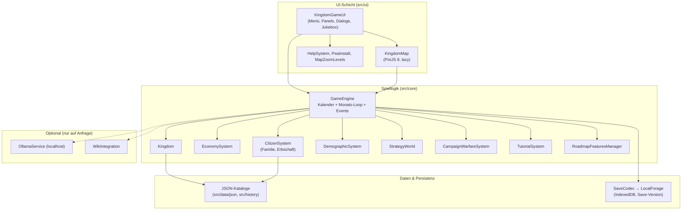
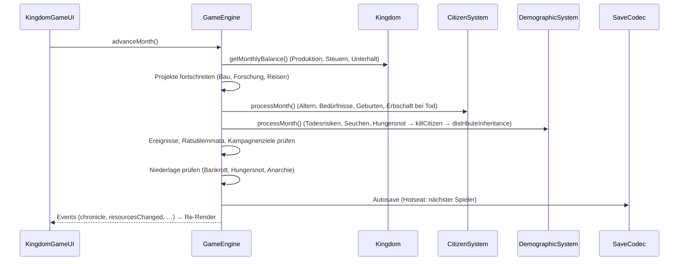

# Architektur-Überblick – Kaiser von Deutschland

**Stand 24.10.2026 · Verbindlich für den Standard-Einstieg**

Diese Doku richtet sich an neue Beitragende: Sie zeigt den tatsächlichen Laufzeitpfad
(`src/main.ts` → `KingdomGameUI` → `GameEngine`) und die Kernsysteme auf einen Blick.
Die ausführliche, teils historische Dokumentation steht in [ARCHITECTURE.md](./ARCHITECTURE.md);
die Zuordnung doppelter Implementierungen in [system-consolidation.md](./system-consolidation.md).

## 1. Einstiegspfad

```text
index.html
  └── src/main.ts                 # Viewport, PWA-Install, Service Worker, KingdomGameUI
        └── src/ui/KingdomGameUI  # Semantisches HTML + responsives CSS, Dialoge, Jukebox
              └── src/core/GameEngine  # Kalender, Monatslogik, Orchestrierung
                    ├── src/core/Kingdom          # Ressourcen, Infrastruktur, Steuer
                    ├── src/core/Economy          # Ernte, Handel, Inflation
                    ├── src/core/CitizenSystem    # Individuelle Bürger, Familien, Erbschaft
                    ├── src/core/DemographicSystem# Geburten, Tod, Seuchen, Hungersnot
                    ├── src/core/StrategyWorld    # Reisen, Nachbarn, Verträge
                    ├── src/core/TutorialSystem   # Interaktive Kampagne
                    ├── src/core/CampaignWarfareSystem
                    ├── src/core/RoadmapFeaturesManager  # Wirtschaftssysteme, Universitäten, …
                    └── src/core/SaveCodec + LocalForage (IndexedDB)
```

Wichtig: `UIFlowManager`, `GameUI`, `EnhancedPixiRenderer` und `MultiplayerSystem` sind
**keine** Teil des Standard-Einstiegs. Sie existieren als Vorarbeiten/Prototypen.

## 2. Schichten-Modell



Regeln:
- Die UI ruft **nur** öffentliche `GameEngine`-Methoden auf, nie Subsysteme direkt.
- Die Engine hält den verbindlichen Kalender; parallele Monatsberechnungen werden abgewiesen.
- JSON-Kataloge werden über `new URL(..., import.meta.url)` geladen, damit Vite sie
  auch im Produktionsbuild ausliefert.
- Persistenz läuft über `SaveCodec` (Versionierung, Migration) nach LocalForage/IndexedDB.

## 3. Der Monats-Loop (Herzstück)

`GameEngine.advanceMonth()` ist der einzige Zeitpfad. Reihenfolge pro Monat:



## 4. Kernsysteme im Überblick

| System | Datei | Verantwortung |
| --- | --- | --- |
| **GameEngine** | [GameEngine.ts](../../src/core/GameEngine.ts) | Kalender, Monats-Loop, Spieler (Hotseat), Events, Save/Load-Koordination |
| **Kingdom** | [Kingdom.ts](../../src/core/Kingdom.ts) | Ressourcen, Bevölkerung (Aggregat), Infrastruktur, Militär, Steuer, `getMonthlyBalance()` |
| **EconomySystem** | [Economy.ts](../../src/core/Economy.ts) | Ernte (Klima, Wetter), Marktpreise, Inflation, Handelschancen, `executeTrade()` |
| **CitizenSystem** | [CitizenSystem.ts](../../src/core/CitizenSystem.ts) | Individuelle Bürger: Familie, Schwangerschaft, Berufe, **Erbschaft** (`distributeInheritance`) |
| **DemographicSystem** | [DemographicSystem.ts](../../src/core/DemographicSystem.ts) | Todesrisiken, Seuchen, Hungersnot; ruft bei jedem Tod die Erbschaft auf |
| **StrategyWorld** | [StrategyWorld.ts](../../src/core/StrategyWorld.ts) | 20 Nachbarn, Reisen, Entdeckung, Handels-/Schutzverträge, Rivalen |
| **CampaignWarfareSystem** | [CampaignWarfareSystem.ts](../../src/core/CampaignWarfareSystem.ts) | Feldzüge, Überfälle, Tribut, statistische Auflösung |
| **TutorialSystem** | [TutorialSystem.ts](../../src/core/TutorialSystem.ts) | Interaktive Kampagne (Bauen → Handeln → Forschen → Reichsrat → Speichern) |
| **RoadmapFeaturesManager** | [RoadmapFeaturesManager.ts](../../src/core/RoadmapFeaturesManager.ts) | Dach für Roadmap-Subsysteme (Wirtschaftssysteme, Universitäten, Marine, …) |
| **SaveCodec** | [SaveCodec.ts](../../src/core/SaveCodec.ts) | Serialisierung, Versionierung und Migration der Spielstände |
| **HistoricalContext** | [HistoricalContext.ts](../../src/core/HistoricalContext.ts) | Spieljahr → Epoche, Referenzsystem, Herrscherwürde (Evidenzgrad `belegt`/`naeherung`/`nicht_verifiziert`) |

### Erbschaft (neu, 24.10.2026)

Beim Tod eines Bürgers (`DemographicSystem.killCitizen`) ruft die Engine
`CitizenSystem.distributeInheritance()` auf:

- **Haupterbe** (50 %): ältester lebender erwachsener Sohn → sonst lebende Ehefrau → sonst ältester lebender Erwachsener der Familie.
- **Rest** (50 %): zu gleichen Teilen an die übrigen Erben (erwachsene Kinder, Geschwister, Familienmitglieder).
- Jeder Erbe erhält ein `inheritance`-Lebensereignis; ohne Erben bleibt das Vermögen beim Verstorbenen.
- Tests: [CitizenInheritance.test.ts](../../src/core/CitizenInheritance.test.ts).

## 5. Datenfluss (Typischer Spielzug)

```
1. Spieler-Klick (UI)            4. Subsystem-Logik
2. KingdomGameUI-Handler    →    5. Kingdom-/Citizen-State-Update
3. GameEngine-Methode         →  6. Engine-Events → UI-Re-Render
                                 7. LocalForage-Autosave
```

## 6. Skalierbarkeit

- **Aggregat + Individuen**: `Kingdom.population` hält Aggregatzahlen (schnell, für
  Wirtschaft/Steuer); `CitizenSystem` hält einzelne Bürger (Familie, Berufe, Erbschaft).
- **Konfiguration**: Schwellen und Limits liegen in [ScalabilityConfig.ts](../../src/core/ScalabilityConfig.ts).
- **Karte**: `KingdomMap` zeichnet Bezirksmarker, keine einzelnen Einwohner; Renderer
  und Timer werden beim Verwerfen freigegeben.
- **Lastmessung**: 20.000 Bürger ≈ 380 ms/Monat inkl. Autosave (siehe
  [Lastmessung](../reports/strategy-population-2026-10-24.md)).

## 7. Erweiterbarkeit – so fügst du ein System hinzu

1. Neue Klasse in `src/core/` (keine UI-Abhängigkeiten).
2. Öffentlichen Getter in `GameEngine` (z. B. `getMeinSystem()`).
3. Aufruf im Monats-Loop an der passenden Stelle (vor/nach Ereignissen dokumentieren).
4. Serialisierung in `SaveCodec` (Version erhöhen, Migration schreiben).
5. UI-Zugang ausschließlich über den Engine-Getter.
6. Unit-Test in `src/core/MeinSystem.test.ts` (Vitest, `npx vitest run`).
7. Doku-Update: diese Datei + [status.md](../00-meta/status.md) + [TODO.md](../../TODO.md).
